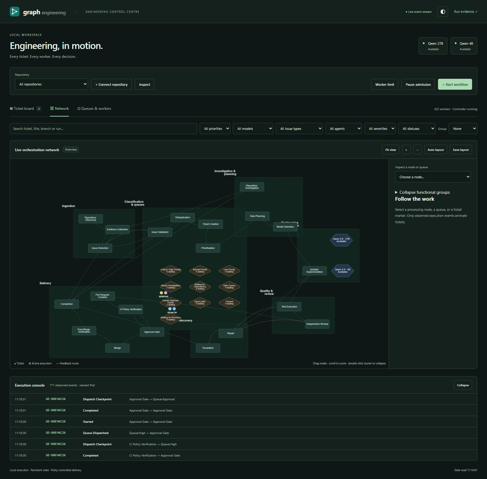
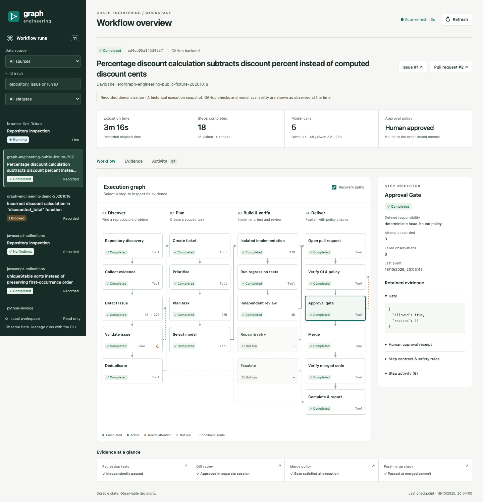

# Graph Engineering

An executable, single-host software engineering controller supervised by Codex.
It sends scoped JSON tasks to local Qwen models through **OpenCode 2.0.32**,
validates proposals, edits isolated Git worktrees, runs frozen regression tests,
reviews actual diffs, and manages issues, pull requests and policy-bound merges.

The project is independent of its target repositories. No target CI, security
policy or agent instruction file is rewritten by the framework.

## Verified outcome

On 20 October 2026 (macOS) the re-engineered platform passed 167 automated tests and
26 real-browser checks. It investigated natural-language tickets on two unrelated
repositories (JS/Python and Go) with live Qwen 4B and 27B through OpenCode, recovered
from a `kill -9` mid model call without duplication, resolved 4/4 seeded defects
end-to-end with zero merge-policy violations, and served its own MCP server to the
official SDK client and to OpenCode. Measured results and limitations are in
[EVALUATION-2026-10-20](docs/EVALUATION-2026-10-20.md).

On 18 October 2026, both supplied model servers were used through OpenCode.
Two unrelated real Git repositories (Python unittest and JavaScript node:test)
completed local issue-to-merge workflows and post-merge tests. A real public
[fixture PR](https://github.com/DavidTheHero/graph-engineering-public-fixture-20261018/pull/2)
merged with explicit human approval, required GitHub CI and branch protection.
Its merge commit is `0b1dbf9444e7287116dd46a71b1fe2411d675f67`; local post-merge
tests and the GitHub push workflow passed.

A private fixture PR remains blocked because its rules API returns HTTP 403.
An actual controller-crash test exposed an issue-creation duplicate in the first
implementation. The corrected ledger forbids creation during uncertain recovery;
a second real crash reconciled exactly one remote issue. Earlier failures are
retained. See [the demonstration report](docs/DEMONSTRATION.md) for receipts,
limitations, operations, counts and evaluation results.

## Install

Requirements: Python 3.10+, Git, OpenCode **2.0.32** (the only version whose provider
configuration has been verified), and reachable OpenAI-compatible model servers.
Optional: Node for JavaScript repositories, an authenticated `gh` for live GitHub, and
the `[mcp]` extra for the MCP server. The controller core has no third-party runtime
dependencies.

```bash
cd graph_engineering
python3 -m venv .venv
.venv/bin/pip install -e '.[mcp]'        # Windows: .venv\Scripts\pip install -e ".[mcp]"
export GRAPH_ENGINEERING_HOME=~/.graph-engineering   # optional; default is ./.runtime
.venv/bin/graph-engineer doctor          # exit 0 = git, OpenCode and at least one verified model id
```

`graph-engineering` is kept as an alias of `graph-engineer`.

## Quick start

```bash
ge=.venv/bin/graph-engineer
$ge doctor                                   # environment, model ids vs /v1/models, MCP handshake
$ge models                                   # registry, reachability, advertised ids and context windows
$ge repo add /path/to/repository             # metadata access only; prints the repository id
$ge repo inspect <repository-id>             # ecosystems, test/build argv, CI and policy files (nothing executed)
$ge ticket create <repository-id> "The agent sometimes gets stuck during tool execution. Investigate."
$ge ui --control --port 8771                 # control centre + durable scheduler; open http://127.0.0.1:8771
# or headless: $ge dispatch --workers 2      (process queued tickets; restart-safe)
$ge run <repository-id> --mode read_only --inspect-with-model   # queue a read-only scan
$ge status                                   # runs; add <run-id> --events for the transition log
$ge mcp serve --profile read                 # MCP over stdio (see docs/MCP.md)
```

Approvals (accepting an enhanced ticket, starting development, trusting code
execution, publishing, approving a merge) are made by a person in the control
centre or the CLI. They are deliberately unavailable to MCP clients.

## Connect another repository

1. `graph-engineer repo add /abs/path`. Detection reads tracked files only. Supported
   ecosystems are Python, JavaScript/TypeScript (npm, pnpm, yarn, bun), Go, Rust,
   Maven, Gradle, .NET, Ruby and Make. Anything else registers with the **generic**
   adapter: read-only investigation works, and execution requires an explicit
   `test_command`. Polyglot repositories are searched across every detected language.
2. Create tickets or read-only scans immediately. Registration never grants code
   execution or publication, and the source checkout is never modified (work happens
   in controller-owned snapshots and worktrees).
3. To let the graph run tests and implement fixes, trust the repository explicitly:
   in the centre, use **Start workflow → trust execution**, or create a configuration
   with `graph-engineer init /abs/path --trust-local-code`. Provision the repository's
   dependencies yourself. Worktrees are **not** a sandbox; see
   [operations](docs/OPERATIONS.md).
4. For GitHub publication: `init … --backend github --slug owner/repo` (requires
   `gh auth login`). Merges stay human-approved and gated by branch protection and CI.

No Graph Engineering code changes are needed per repository. On 2026-10-20 the same
controller investigated General_AI_Agent (JS + Python) and google/uuid (Go). See
[the evaluation](docs/EVALUATION-2026-10-20.md).

## Models

`<home>/models.json` (example: [configs/models.example.json](configs/models.example.json))
is the provider registry. Any OpenAI-compatible endpoint works. Each entry has a
`tier` (`large`/`small`), a `label` and optionally `roles` and `api_key_env` (never an
inline key). Nodes request roles, not servers. `routing.py` resolves a role through
the profile (`baseline` = large tier for everything; `multimodel` = small tier for
triage and review, large tier for investigation, planning and implementation) and
the latest observed health. A complex role never silently falls back to a small model
unless it is listed in `small_fallback_roles`. Every fallback is a persisted
`degraded_routing` event. See [ADR 006](docs/ADR-006-capability-routing.md).

**Automatic assignment:** `graph-engineer models assign --endpoint URL …` probes every advertised model through OpenCode (structured output, verified citations, long-context grounding) and assigns each graph role an ordered list of qualifying models. It is a dry run until `--apply`. See [model assignment](docs/MODEL-ASSIGNMENT.md).

## Infrastructure faults

Worker startup stalls, timeouts and unavailable or busy models are retried automatically with backoff (15 s, 30 s, 60 s, 120 s). They do not spend a step's attempt budget. Tickets wait in the **Retry** queue with the reason shown, and are dead-lettered with the exact cause only when the allowance (`max_infrastructure_retries`, default 4) is exhausted. A silent OpenCode worker is detected after `startup_timeout` (45 s), not the 120 s call timeout. See [ADR 008](docs/ADR-008-infrastructure-faults.md).

## MCP server

One standards-compliant server exposes repositories, tickets, runs, events,
artifacts, the executable graph and model health. Profiles are `read`, `operate` and
`admin`; every call is audited. It runs over stdio or loopback HTTP with a bearer
token. Client setup for Codex and OpenCode, the tool list and the security model are
in [docs/MCP.md](docs/MCP.md).

Architecture overview and diagram: [docs/ARCHITECTURE.md](docs/ARCHITECTURE.md).
The audit behind this revision: [docs/AUDIT-2026-10-20.md](docs/AUDIT-2026-10-20.md).

## Live engineering control centre

**Plain-language tickets:** choose a repository, click **+ Create Ticket**, describe
the problem and select **Create & Investigate**. The report is saved immediately;
Qwen 4B classifies it and Qwen 27B investigates committed source through OpenCode.
Compare the original and enhanced ticket, inspect evidence, follow its live graph
journey, request clarification, and approve the current revision for development
queue admission or issue publication. Opt-in repository autonomy can dispatch
accepted revisions through regression, implementation, review and delivery.
For a blocked ticket with persisted unresolved questions, **Ask Qwen 4B** runs a
bounded OpenCode worker and records evidence-labelled proposed answers before
returning the ticket to the same blocked execution step without spending a retry.
See the [ticket investigation guide](docs/TICKET-INVESTIGATION.md) and
[actual Phase 3 results](docs/PHASE3-RESULTS.md).

```powershell
cd D:\git_code\graph_engineering
.\.venv\Scripts\graph-engineering.exe --home .runtime/general-ai-agent centre --port 8771 --workers 2
```

Open **[http://127.0.0.1:8771](http://127.0.0.1:8771)**. The Ticket Board,
Network, and Queues & Workers views share persistent backend state. Connect a
repository, inspect it, then choose **Start workflow**. New repositories default
to read-only source inspection. Development requires explicit trust of local
code execution; GitHub publication follows the repository's existing configuration.

Select a ticket and **View ticket journey** to follow its recorded path and replay
its history. The network shows real conditional routes, repair loops, queues,
model assignments and concurrent executions. Markers move only for persisted
backend transitions. Closing the browser does not stop the controller.

On 19 October, the new scheduler ran **nine actual Qwen calls through OpenCode**:
4B investigated `General_AI_Agent` and investigated/reviewed two disposable
repositories; 27B planned and implemented both fixes. Both frozen regression suites
passed and both local PRs stopped for human approval. Four cross-ticket model-call
overlaps were observed. The General repository's uncommitted work was preserved.
Its source observations remain unconfirmed, clearly distinguished from bugs.

A separate, labelled test-double demonstration exercises the review/repair loop
and parallel quality checks. No new live GitHub operations were performed in this
phase. See the [control-centre guide and acceptance evidence](docs/CONTROL-CENTRE.md).



## Earlier read-only evidence dashboard

```powershell
.\.venv\Scripts\graph-engineering.exe ui
```

Open **[http://127.0.0.1:8765](http://127.0.0.1:8765)**. Select a run and click a
graph step to inspect its status, worker, attempts, evidence and safety contract.
The Evidence view shows regression output, the actual diff, independent reviews,
model receipts and merge decisions. Activity shows the chronological audit trail.
Search and filters help find completed, blocked or approval-waiting runs.

The dashboard refreshes live controller state every three seconds. Historical
demonstrations are explicitly labelled **Recorded**; local publication backends
are labelled as simulated GitHub operations. To watch a different controller:

```powershell
.\.venv\Scripts\graph-engineering.exe --home 'D:\controllers\example' ui --port 8765
```

This is a read-only, loopback dashboard. Run management and approvals stay in the
CLI. It needs no Node installation, frontend build, internet access or additional
Python packages. See [dashboard operation and verification](docs/DASHBOARD.md).



## Repair runs from a reproduced failure (CLI)

Start with a **clean, current base checkout**. Provision its dependencies yourself;
the controller does not install packages or run unreviewed setup commands.
Supported initial adapters are Python (unittest/pytest) and JavaScript/TypeScript
(package scripts or node:test). Custom test argv may override detection.
For nonstandard regression helpers, add their glob paths to `protected_paths` in
the operator configuration. Conventional test names and explicit test script files
are frozen automatically; baseline execution must leave the repository clean.

```powershell
$ge = 'D:\git_code\graph_engineering\.venv\Scripts\graph-engineering.exe'
& $ge init 'D:\path\to\repository' --trust-local-code --routing multimodel
# Use the exact config path printed by init:
& $ge scan --config '<printed-config-path>'
& $ge status '<run-id>' --events
& $ge resume '<run-id>'
```

`scan` reproduces a failure, validates/deduplicates it and creates a local ticket,
then stops before planning. `execute --config <path>` starts a complete new run.
Use `resume` to continue the existing scan; starting another run against the same
failing base is deduplicated. Only a reproduced failing test/exception becomes an
actionable finding. Speculative, environmental and low-confidence findings block
for supervisor investigation. Existing unmarked issues with matching titles or
file/test evidence block speculative duplicate creation; confirmed linkage needs
the operator to attach the displayed marker to the existing issue, then resume.

Use a single controller `--home` for each coordinated deployment. The default is
this project's `.runtime`, which keeps all controller files in this folder.
Different repositories may run in separate processes; mutations within a repository
are serialized by an OS file lock. Independent controller homes/machines are not
coordinated. Preserve the whole home directory to resume a run.

Local execution is **disabled by default**. `--trust-local-code` explicitly permits
repository code to run as your current OS account. Worktrees, tool denial and a
filtered environment are not a hostile-code sandbox. Use a credential-free VM or
separate OS execution account for untrusted code; this initial release has no
built-in Docker/VM runner. GitHub credentials stay in the controller, not worker or
test environments, but same-user hostile processes could still access host files.

## Live GitHub and approvals

```powershell
gh auth status
& $ge init 'D:\path\to\repository' --backend github --slug owner/repository `
    --trust-local-code --routing multimodel
& $ge execute --config '<printed-config-path>'
& $ge status '<run-id>' --events
# Review the actual diff, test receipts, review and GitHub policy snapshot first:
& $ge approve '<run-id>' --head '<full-tested-sha>' --actor '<human-name>'
& $ge resume '<run-id>'
```

The controller pushes only its scoped branch to the verified GitHub repository.
It never force-pushes, changes protections, supplies `--admin`, or counts model
comments as required human reviews. Required external CI and GitHub App sources
are checked independently of the controller's own test status. Missing/failed or
pending checks, unknown policy, stale heads, changed base, conflicts and missing
approval block merging. Resume after pending CI completes. The live backend
leaves the original local base checkout untouched after remote merge: fetch and
fast-forward it explicitly before starting the next run.

Human approval is the default. Automatic merge is opt-in (`--auto-merge`), additionally
requires a configured `auto_merge_paths` allowlist, trusted code, low severity,
small changes, no sensitive paths, independent passing tests/review and current
repository policy. An empty allowlist permits no automatic merges. No automatic
live merge was performed in the demonstration.

`resume` resets only the current node's attempt budget and records that action.
For an uncertain external write it performs read-only reconciliation. If GitHub
does not show a unique matching object, the controller stops rather than trying
another create. Resolve ownership/visibility with evidence; do not delete ledger
rows just to make a blocked run continue.

## Persistent controller, monitoring and cancellation

```powershell
& $ge enqueue --config '<printed-config-path>'
& $ge serve --poll 5
# In another terminal:
& $ge status '<run-id>' --events
& $ge stop '<run-id>'
& $ge resume '<run-id>'
```

`serve` is a separate restartable foreground controller, independent of an
interactive Codex session. Run it under your service manager or, on Windows,
`Start-Process -WindowStyle Hidden` with log redirection. `serve --once` processes
one queue sweep. It never auto-approves; blocked CI/policy runs require explicit
resume. Cancellation is persisted and checked between nodes and during worker/test
execution; process trees are killed on active worker/test cancellation or timeout.
Git/API operations have bounded timeouts; these operations finish or time out before
the next cancellation boundary. Detached hostile children require OS containment.

SQLite WAL persists versioned run state, transitions, approvals and write intents.
Each attempt retains hashed input/output receipts. Worker invocations keep separate
OpenCode profiles, session IDs, prompts, generated V2 configuration and raw output.
Artifacts and logs can contain proprietary source: restrict access to controller
storage. Known environment secrets and GitHub token patterns are redacted; this is
not a general-purpose detector for arbitrary secrets committed to a repository.

## Routing profile measurements (18 October, Windows)

| Profile | Investigation | Planning/implementation | Independent diff review |
|---|---|---|---|
| `baseline` (default) | A | A | A in a separate session |
| `multimodel` | B with selective retrieval | A | B; contradictory output escalates to A |

A is `qwen3.8-27b` at `http://192.168.0.60:18020/v1` (advertised context 150000).
B is `docker.io/local/qwen35-4b:8k` at `http://192.168.0.62:18035/v1` (8192).
Output limits 4096/1024 are controller choices, not claims about server maxima.
Missing identifiers and unavailable servers fail closed; configured A fallback is
explicitly logged where used. Large review tasks route to A when B's byte budget
cannot safely include the evidence. Set `allow_same_model_review=false` if a
different model is mandatory; no model can approve a merge without deterministic gates.

The current two-defect evaluation measured 34.85 seconds per multi-model task and
23.27 seconds per A-only task, with equal observed completion. Consequently A-only
is the default; the multi-model mode is available for controlled comparisons.
These are small descriptive samples, not a general model ranking. Both endpoints
accepted invalid authentication in probes. Protect the inference network and add
authentication/TLS before production use. If credentials become required, configure
`api_key_env` per model; never put their values in configuration files.

## Test and repeat the demonstration

```powershell
python scripts/verify.py
python scripts/run_evaluation.py --output evidence/evaluation/new-run --mode both --merge-local
.\scripts\demo.ps1
& $ge graph
```

The evaluation creates fresh real Git repositories and calls real local models.
`--merge-local` explicitly authorises local test approvals and real local Git merges;
GitHub objects are simulated in that backend. Omit it to stop at approval.
The PowerShell demo stops for approval. Existing fixture directories are never
overwritten. Tests using worker doubles are explicitly labelled as unit tests.

Run `probe_tool.py` only for the disposable read capability probe; production
workers deny all tools. `live_recovery.py` and `setup_public_fixture.py` target the
specific authorised demonstration repository and are not general setup commands.
Do not rerun their creation/setup steps against a repository you have not authorised.

## Project layout

```text
graph_engineering/
  pyproject.toml              # package and CLI
  src/graph_engineering/
    cli.py                   # graph-engineer: doctor/repo/ticket/run/ui/mcp/models + init/scan/execute/approve/serve
    mcp_server.py            # MCP protocol adapter: tools, resources, stdio and loopback HTTP
    capabilities.py          # protocol-neutral capability layer: profiles, audit, validation
    routing.py               # role -> tier -> healthy model selection with explicit fallback
    adapters.py              # ecosystem detection: py/js/go/rust/jvm/.NET/ruby/make/generic
    workflow.py              # node registry, enforced CONDITIONAL_EDGES and node handlers
    runtime.py               # SQLite, lock, deadlines, artifacts and effect ledger
    repository.py            # Python/JS adapter interface, worktrees and verification
    models.py                # model registry, id discovery, V2 config and isolated OpenCode sessions
    publication.py           # local and live backends; independent merge gates
    evaluation.py            # real defect seeds and measured evaluation
    tickets.py               # persistent ticket metadata and idempotent commands
    scheduling_policy.py     # deterministic priority, aging, status and backoff
    scheduler.py             # subprocess node leases, capacity and crash recovery
    control_repositories.py  # registration and pinned, isolated repository snapshots
    control_api.py           # protected operator command dispatch
    centre_data.py           # shared board/network/event projection
    quality.py               # explicitly opted-in quality fan-out and fan-in
    dashboard.py             # loopback operator API, SSE and bundled web assets
    web/                     # board, graph, inspectors, replay and local Cytoscape
  tests/                     # unit, integration and failure injection
  scripts/                   # repeatable demos, probes, verification and recovery
  configs/                   # repository and V2 examples
  docs/                      # ADR, research, contracts, operations and actual results
  evidence/                  # raw model/API/test/source/CI receipts
  .runtime/                  # default durable controller storage (ignored)
  .venv/                     # prepared installation (ignored)
```

Accepted natural-language tickets can now enter the existing repair graph under
an opt-in **Autonomy policy**, with reviewed regression-test generation, immutable
tests, bounded recovery and optional issue/PR delivery. New repositories remain
read-only. See [autonomous operation](docs/AUTONOMOUS-DEVELOPMENT.md) for dashboard
controls and the Windows supervised controller.

The current scope is bounded source repair driven by reproducible test failures.
Existing tests/manifests/instructions/CI/security files cannot be changed by workers.
Locked npm installation is opt-in and disables lifecycle scripts. Broad vulnerability
discovery, semantic issue deduplication, automatic rebasing, merge queues and
distributed scheduling need further implementation. Automated revisions after
external GitHub review requests also need implementation; the current repair loop
reviews and corrects changes before publication. For unattended production, add
real execution isolation, an authenticated approval service, storage access
controls/backups, broader workload evaluations and supported GitHub rules.
See [security and operation limits](docs/OPERATIONS.md) and the [ADR](docs/ADR-001.md).
