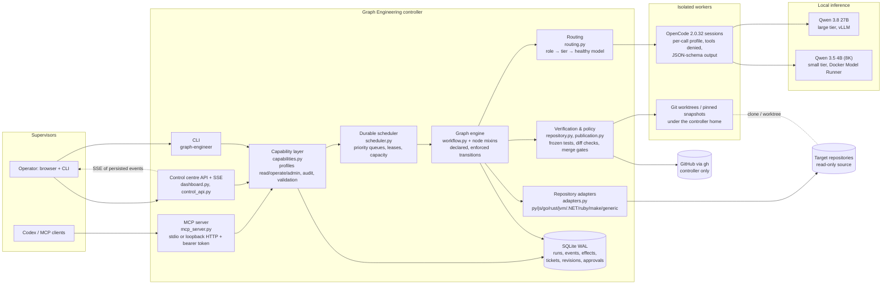

# Architecture

Graph Engineering is a single-host engineering controller. It is independent of the
repositories it works on: everything repository-specific is discovered by adapters or
supplied as configuration. Codex (or any MCP client, or a human) supervises it through
one capability layer. Qwen models do bounded work through isolated OpenCode sessions.
Deterministic code decides whether that work passed.

## Components



### Layers and their contracts

| Layer | Modules | Responsibility | Must never |
|---|---|---|---|
| Interfaces | `mcp_server.py`, `dashboard.py`, `cli.py` | Speak MCP, HTTP/SSE and argv | Contain business rules |
| Capability | `capabilities.py`, `control_api.py` | Permission profiles, idempotent commands, audit | Expose approvals to agents |
| Orchestration | `scheduler.py`, `workflow.py`, `investigation.py`, `accepted_development.py`, `question_answering.py` | Leases, queues, graph nodes, checkpoints, retries | Take a transition not in `CONDITIONAL_EDGES` |
| Routing | `routing.py`, `models.py` | Pick a model by role, tier, profile and health; run OpenCode | Silently substitute a small model for a complex role |
| Repository | `adapters.py`, `repository.py`, `control_repositories.py` | Ecosystem detection, worktrees, snapshots, bounded commands | Execute code without `trusted_local` |
| Verification and policy | `repository.py`, `publication.py`, `workflow.py` gates | Frozen tests, diff scope, head-bound approvals, merge gates | Accept a model's claim as proof |
| Persistence | `runtime.py`, `tickets.py`, `report_store.py` | SQLite WAL, events, effect ledger, revisions | Overwrite history |

### Execution model

1. A ticket is a row in `tickets` pointing at a run in `runs`. The run's `node` is
   the durable cursor and `state` holds the validated artifacts.
2. `serve_scheduler` claims the highest effective-priority eligible ticket. A ticket is
   eligible when its repository is not leased, its model has capacity and is not
   observed down, and routing can place its next step.
3. A separate `worker-step` process executes exactly one node under an OS lock and
   checkpoints. The scheduler re-queues the ticket, so concurrent tickets interleave
   at node boundaries.
4. A handler returns `(updates, next_node, status)`. The engine validates the output
   schema and checks that the transition is declared, then commits the state and an
   event in one transaction.
5. External side effects (issues, PRs, comments, merges) go through `Store.effect`:
   the intent is recorded first and reconciled on resume. An uncertain outcome is
   never blindly retried.
6. The browser animates only persisted events, delivered over SSE. MCP clients read
   the same events through `run_events` / `ticket_timeline`.

### Graph clusters (from `workflow.NODES`)

* **Intake and investigation:** `manual_intake → request_triage → request_duplicate_check →
  repository_search ⇄ problem_investigation → ticket_enhancement → reproduction_check →
  finding_validation (→ problem_investigation retry) → ticket_finalisation`.
  Human gates follow, either `development_admission` or `ticket_publication`.
* **Accepted development:** `development_setup → regression_authoring ⇄ regression_review →
  regression_validation → task_planning → model_selection → isolated_implementation →
  test_execution → independent_review (→ repair → isolated_implementation) →
  development_delivery / pull_request_creation`.
* **Repair from a reproduced failure:** `repository_discovery → evidence_collection →
  issue_detection ⇄ issue_validation → deduplication → ticket_creation → prioritisation →
  task_planning …`.
* **Delivery:** `pull_request_creation → ci_policy_verification → approval_gate (waits for
  a human) → merge → post_merge_verification → completion`.

`graph-engineer graph` and the MCP `workflow_graph` tool export the exact set of
transitions that the engine enforces.

## Autonomous investigation (2026-10-21)

Intake investigation establishes repository facts itself instead of asking the requester:

* the large model sees the committed source file listing and may name up to six `read_files`
  for the next search round (only paths in the filtered listing; requested files are read first,
  whole when short, and lines over 300 characters are truncated so one line cannot hide a file);
* the prompt forbids questions the repository can answer; product choices with a safe default
  are recorded as `Assumption:` limitations;
* before a ticket waits for a person, `ticket_finalisation` sends the model's own questions back
  for `SELF_RESOLUTION_ROUNDS` (1) additional search-and-investigate round per operator generation,
  with its own reference-correction retry, recorded as a `self_resolution` event;
* a grounded ticket (all references verified, at least one finding) proceeds to review with any
  remaining questions visible; only an ungrounded ticket waits in Needs Information.

Measured on a copy of GE-30D05C40 (Qwen 3.8 27B): the two repository questions it previously asked
were answered from `backend/llm.js:84` and `frontend/src/App.jsx`, and the ticket reached review with
four verified references and no questions. Review, development authorisation and merge approval
remain human gates unless a repository's autonomy policy says otherwise.

## Policy-owned recovery (2026-10-21)

GE-30D05C40 stopped six times in one day; five stops were controller or environment faults, and each
ended with a person pressing Retry. The repository autonomy policy now owns recovery:

* **Budgets.** With `development` on, `max_repairs` and `max_node_attempts` (1–4 each) come from the
  policy; accepted-development nodes use that attempt budget directly, and the regression authoring
  and review rounds scale with it. The engine applies the policy's current budgets at every step
  (`policy_budget_applied`), so a budget raised while a run is stuck counts at its next attempt; a
  budget lowered below what a run has used blocks or escalates it at its next step, recoverably.
* **Proposals build on the round.** The implementer is shown the diff of edits earlier proposals of
  the round already made (`current_edits`); an edit whose replacement text (20+ characters, absent
  at the accepted commit) is already present once is skipped rather than refused
  (`edits_already_applied`; marker edits are expanded first and never skipped), a proposal with
  nothing left to apply is refused with that reason fed back, and a fragment refusal names the file,
  the match count and the fragment.
* **Recovery rounds.** A blocked or escalated development is retried automatically, with the restart
  the stop needs (re-author, fresh setup, re-plan), for `recovery_rounds` (0–6) rounds. Each round is
  an `autonomy_recovery` event; when the ticket's retry limit is exhausted the round extends it by one
  (`retry_budget_extended`), so `retries n/m` stays honest. `UNRECOVERABLE` stops (the requirement,
  policy or repository must change first) are never retried. While rounds remain the ticket is not in
  "Needs you".
* **GitHub publication follows the repository's PR convention.** The tested local branch
  `graph/<run>` is pushed under `<feat|fix>/<issue>-<slug>` and the PR body carries `Closes #N`
  and Change / Validation / Review sections built from recorded evidence only
  (`publication_branch`, `publication_body`), so a PR policy such as General_AI_Agent's passes.
  The published name is chosen once as a durable effect; a branch of that name with other history
  on GitHub is never pushed over, the run publishes under `<name>-<run prefix>` instead, and the
  PR record carries the published name. The local simulation backend keeps `graph/<run>`.
* **The reviewer is told the facts.** The independent review prompt states the controller's own test
  run as facts (`verification`: full suite and regression passed or not) and labels the pre-change
  output as such. A rejection whose blocking findings cite a test failing, while the suite passed,
  is re-asked once with the contradiction pointed out (`review_reconsidered`; if that second ask
  cannot be made the first answer stands, `review_reconsideration_failed`); both answers are kept
  (`prior_review`, omitted from the planner prompt and the published review) and the second
  decision stands, whichever way it goes. Rejections for other defects are never re-asked.
* **Repairs widen, never narrow.** A repair re-plans from the latest failure, but keeps the previous
  plan's files and adapted tests (`plan_widened` event): their edits stay in the worktree, so one
  failure can never undo the half of the change it is not about. Only a fresh round after escalation
  starts again from the accepted commit.
* **Automatic acceptance.** `auto_accept` accepts an investigated ticket whose references verified and
  that has no open questions; the `accept` action re-checks the policy at execution time.
* **Human gates that remain.** Clarification when evidence is missing, acceptance when questions
  remain, publication under the existing `publish` flag, and **merge approval, always**.

## Adapting existing tests (2026-10-21)

Every existing test file is frozen during development so an agent can never weaken tests to go green.
A feature that changes a contract (GE-30D05C40 adds a `model` key to the chat response; `agent.test.js`
asserts the exact old key list) legitimately needs the pinning test updated. Under the repository policy
flag `adapt_existing_tests` the controller allows that, bounded at five points:

1. a plan may include an existing test only once the frozen regression passes and only if that test
   fails in the latest verification (`adaptable_tests`; recorded as `existing_tests_planned`); a test
   adapted earlier in the same round stays adaptable, and an edit refused by bound 4 is reverted to the
   accepted commit before the repair (`adapted_test_refused`);
2. the implementer is told to adapt only the assertions that pin the old behaviour;
3. `validate_edits` accepts only those test paths; all other test files stay out of scope;
4. `adapted_test_intact`: the file must keep every test definition and gain no skip markers;
5. the independent review must report a required finding if any assertion was removed or weakened,
   and the merge-approval card lists the adapted tests.

## Directory structure

```text
graph_engineering/
  pyproject.toml                 core has no runtime dependencies; [mcp] extra adds the SDK
  src/graph_engineering/
    cli.py                       graph-engineer: doctor, repo, ticket, run, ui, mcp, models, dispatch…
    mcp_server.py                MCP protocol adapter (tools, resources, stdio/HTTP)
    capabilities.py              protocol-neutral capability layer, profiles, audit
    control_api.py               idempotent operator command dispatch (shared by UI and MCP)
    workflow.py                  node registry, CONDITIONAL_EDGES, engine, repair/delivery nodes
    investigation.py             natural-language intake and evidence validation nodes
    accepted_development.py      regression-first development nodes
    question_answering.py        bounded small-model answers to ticket questions
    scheduler.py                 durable multi-process dispatch, capacity, crash recovery
    scheduling_policy.py         priority aging, backoff, board column mapping
    routing.py                   role → tier → model selection with health and policy
    models.py                    model registry, discovery, OpenCode V2 worker
    adapters.py                  ecosystem detection (no code execution)
    repository.py                discovery, bounded commands, worktrees, edit validation
    control_repositories.py      registration, pinned snapshots, workflow starts
    publication.py               local and GitHub backends, merge gates
    runtime.py                   SQLite WAL store, events, effect ledger, OS locks
    tickets.py, report_store.py  tickets, queues, natural-language reports, revisions
    centre_data.py, dashboard*.py, web/   control centre projection, SSE, UI
  tests/                         unit, integration, protocol and failure-injection tests
  scripts/                       evaluation, benchmarks, probes, evidence capture
  configs/                       models.example.json, repository and OpenCode examples
  docs/                          ADRs, audit, operations, MCP, evaluation results
  evidence/                      raw receipts from real runs
```
