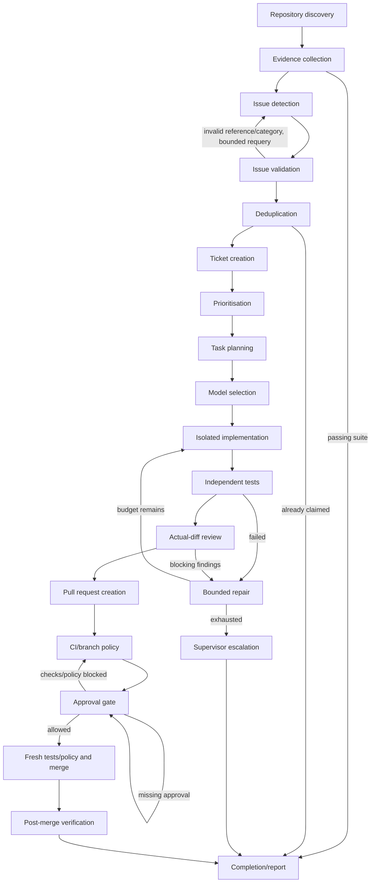

# Stateful graph and contracts

The executable registry is `workflow.NODES`; `graph` and `node-contracts.json`
export its input/output JSON schemas, responsible worker/tool, permissions, edges,
deadline, attempts, checkpoint/evidence rules and escalation. Every input envelope
includes operator configuration, task ID and repair count. Optional feedback and
conditional outputs are declared separately. Worker artifact schemas additionally
validate nested candidate, plan, file-edit and review fields. Domain postconditions
are checked in the handlers by actual process/Git/API operations.

## Node obligations

Every row uses two attempts and a 120-second node I/O deadline by default, retains
a JSON attempt receipt with input/output hashes, and checkpoints its transition
transactionally. Model and command timeouts inherit the remaining node deadline.
Repair loops are bounded to two corrections; total execution also has a node budget.
Approval/CI observation can be repeated through explicit resume without recreating
side effects. Any undeclared output, invalid artifact, exhausted attempt, permission
denial or unavailable evidence blocks for the supervisor. Cancellation preserves the
current cursor and terminates active worker/test processes.

| Node | Preconditions and input | Verified postcondition / conditional edge | Authority and retained evidence |
|---|---|---|---|
| Repository discovery | Clean Git root, configured base, compatible stack | Local HEAD matches configured base; GitHub base must match when live | Read Git, history, manifests, tests, CI, contribution/agent files; repository JSON |
| Evidence collection | Explicit trusted-local execution | Frozen test/config hashes; observed exit and nonempty suite. Passing tests route to clean completion | Detached base worktree and bounded adapter argv; raw test output and selective source bundle |
| Issue detection | Actual failed check and numbered source snippets | Strict candidate schema with verified file/line, expected/actual, confidence/category/acceptance | B in multi-model mode, A baseline; no tools; raw OpenCode session and JSON |
| Issue validation | Candidate plus base evidence | Valid location, high-confidence actionable category, independent repeat failure. Invalid references/categories trigger bounded requery; otherwise stop | Deterministic file and reproduction checks; requery uses A and preserves feedback |
| Deduplication | Canonical repository/base/test fingerprint | Unique finding owner, or route to duplicate completion | SQLite unique constraint; remote marker/title/file-test safeguards at publication |
| Ticket creation | Validated reproduced finding | Observed local or remote issue ID | Backend issue write with durable intent; uncertain recovery reads only; exact logs, SHA and acceptance in body |
| Prioritisation | Validated severity | Deterministic P1/P2/P3 mapping | No external write; priority artifact |
| Task planning | Complete bounded source, candidate and acceptance | Planned files belong to allowed complete source snippets | A JSON proposal; no shell or edits; plan receipt |
| Model selection | Approved scope and discovered model ID | Implementation model health observed | Read `/models`; log degraded routing and health failures |
| Isolated implementation | Pinned base, task branch and plan | Worktree common Git dir/ancestry verified; only approved source proposals applied | A in a separate tool-free session; path validation, branch/worktree and complete-file proposal |
| Test execution | Proposed edits and frozen baseline | Test/config files unchanged, no extra files; independently executed tests/builds pass; observed commit and actual diff. Failure routes to repair | Deterministic argv, no controller tokens; logs, commit SHA, diff, frozen hashes |
| Independent review | Actual diff, before/after receipts | Blocking findings route to repair. Contradictory approval plus blocking findings is preserved and escalated to deeper A review | B or independent A session; model identity, session ID, findings and rationale; never substitutes for tests/approval |
| Repair | Failed test or review and prior repair count | Increment count; retry scoped implementation or escalate when exhausted | No publication; feedback preserved, same owned branch |
| Escalation | Exhausted correction budget | Explicit unresolved terminal report | Supervisor; no successful completion/merge claim |
| PR creation | Tested commit, actual-diff review, issue and branch | Observed PR, linked issue, review COMMENT, exact-head test status | Verified HTTPS push and normal GitHub API; stable branch/marker; uncertain creates cannot repeat |
| CI/policy verification | PR and tested SHA | Current checks, source App IDs, required reviews, policy and mergeability snapshot | GitHub REST/GraphQL, or explicitly simulated local objects; unknown rules/read errors block |
| Approval gate | Snapshot, tested head, review and policy | Exact SHA approval or scoped trusted-low-risk auto policy; all independent gates must pass | Read local approval ledger and fresh GitHub state; missing approval waits, other failures block |
| Merge | Allowed gate, unchanged worktree/head/base | Fresh regression and policy checked again; normal merge pinned to head; merged commit actually observed | Controller only; durable merge intent, server result and follow-up observation; no admin/force bypass |
| Post-merge verification | Observed merged SHA | Detached worktree at that SHA passes the same frozen regression | Deterministic adapter; raw logs. Failure blocks remediation and never pretends to undo the merge |
| Completion/report | Proven final state or explicit clean/duplicate/escalated outcome | Close issue only after verified merge; write self-contained final JSON | Controller report includes state, artifacts, model calls, decisions and transition history |

The initial discovery sources are reproducible test failures, repository history and
source, not broad model-generated improvement lists. The scanner does not claim
to validate security advisories or reproduce every build system. Existing failing
tests act as frozen regressions; workers cannot weaken them. New-test generation is
outside the initial implementation. This restriction makes the demonstrated proof
stronger while limiting compatible fixes.
